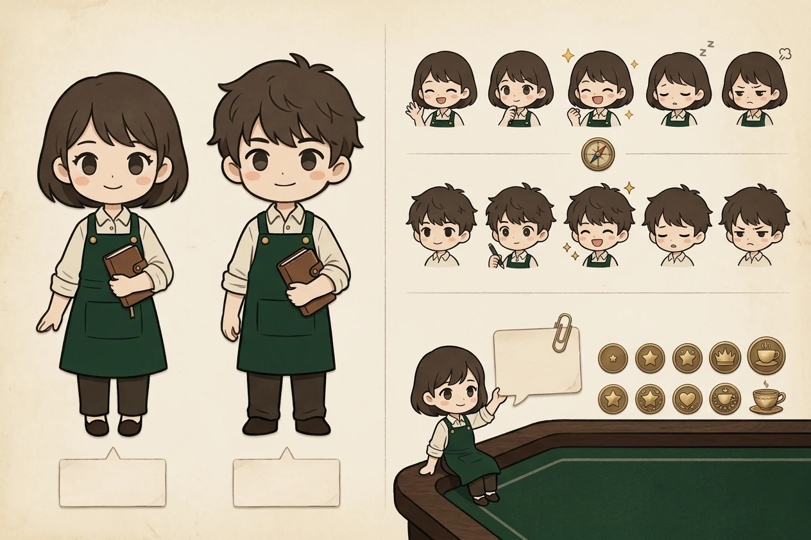

# 桌宠形象规范（Q 版）

`concept.webp` 是桌宠的**唯一形象基准**（2026-11-04 定稿方向）。凡是新场景（新页面、新表情、新道具、宣传物料、正式立绘重绘）用到桌宠，都先对照本页，不要另起炉灶。正式立绘待人工绘制；当前 `src/assets/desk-pet/*.webp` 是从这张图裁出来的占位。

## 角色

- 酒馆里的小帮手，二十出头，**男女两版可选**，性格相同。
- 站在**客户（玩家）一侧**：陪玩家看经理出招，不给玩家打分，也不教玩家怎么演。
- 它是项目的 Agent 的「脸」：对话、派活、等人拍板都通过它。

## 外形（两版共用）

| 项 | 规范 |
|---|---|
| 比例 | Q 版约 2.5 头身，保持概念图比例，不拉长、不改成写实 |
| 服装 | 米白衬衫（袖口挽起）＋深绿围裙（黄铜扣、胸前口袋）＋深棕长裤＋深色鞋 |
| 标志道具 | **棕色小皮账本**（带搭扣）。账本 = 账本事件流，是它最重要的识别符号，不能换成手机、平板或酒杯 |
| 发型 | 女版：深棕齐耳波波头、齐刘海；男版：深棕蓬松短发、有几撮翘起 |
| 面部 | 大圆眼、腮红、简单线条嘴；描边为深棕色，不用纯黑 |
| 画风 | 手绘描边＋平涂，纸质暖调，与牌桌/卡纸风格一致 |

## 色板（取自 `docs/design/ui-asset-library-v1.md`）

深绿 `#0F2D1F`（围裙、牌桌）· 深木 `#4D3624`（账本、长裤、描边）· 卡纸 `#EBE0CE`（衬衫、便笺）· 黄铜 `#B28C52`（扣子、徽记）· 暖黄 `#F4D06F`（高光、欢呼星星）· 砖红 `#CC092B`（只用于警示，不用在桌宠身上）。

## 表情（每版 5 个，顺序同概念图）

| 键 | 表情 | 什么时候用 |
|---|---|---|
| `wave` | 挥手笑 | 打招呼、默认待机 |
| `think` | 拿笔想 | Agent 正在想、正在调用 Worker |
| `cheer` | 欢呼（带星星） | 事情办成、翻开隐藏牌 |
| `sleepy` | 打瞌睡（Zz） | 闲置一段时间 |
| `pout` | 鼓腮 | 被拖着走、出错受阻 |

新增表情时，沿用同样的头像裁切（胸口以上、围裙肩带可见）和同样的描边粗细。

## 场景用法

- **坐在牌桌角**：默认姿态，侧身坐在牌桌木边上，举着回形针便笺说话（概念图右下）。
- **便笺气泡**：卡纸色便笺＋黄铜回形针，是它说话的标准容器。
- 通话中玩家不问，就只用表情看牌。玩家开口时，小贝在同一段会话里回答。

## 不要做

- 不加数值条、饥饿度、心情值、成长阶段（2026-11-04 已否决）。
- 概念图里的徽章（星星、皇冠、茶杯）来自已作废的「熟客等级」设定，**不使用**。
- 不用暴雪或其他已有 IP 的形象元素；不用中年掌柜形象（已作废）。
